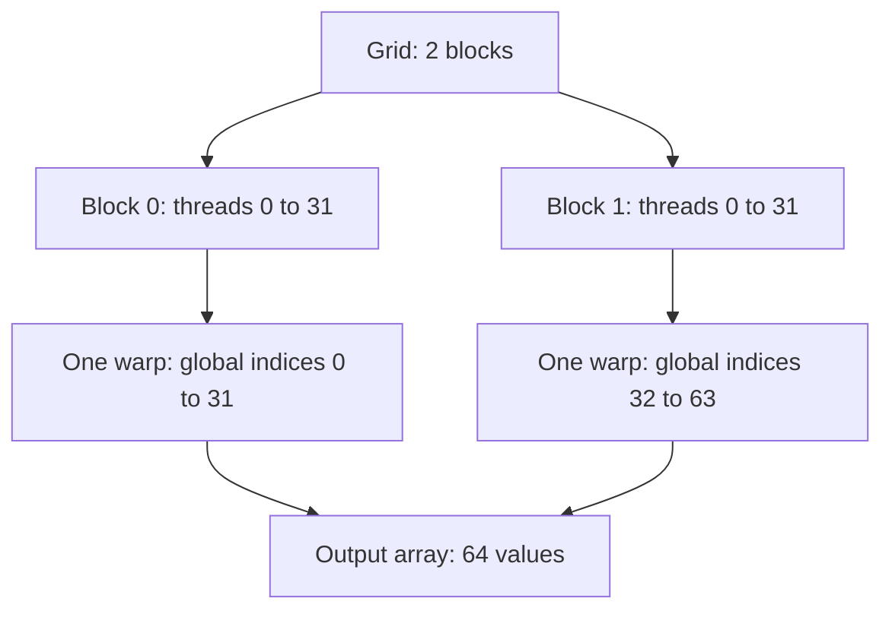

# Lesson 3 — Computer Architecture

## Book location

| Field | Reference |
|---|---|
| Book | Cheng, Grossman, and McKercher, *Professional CUDA C Programming* (2014) |
| Chapter | 1 — Heterogeneous Parallel Computing with CUDA |
| Section | Parallel Computing (starts p. 2) |
| Subsection | Computer Architecture (starts p. 6) |
| Reading | Printed pp. 6–8, including the end of this subsection on p. 8; stop at Heterogeneous Computing |
| Roadmap ID | 1.1.3 — [learning roadmap](cuda-learning-path.md) |
| Experiment | Write each thread's global index into an array |
| Status | Implementation prepared; build/run record below; user profiling pending |

## Core idea

Logical CUDA threads, warps, blocks, and grids map onto physical execution resources; they are not physical core identifiers.

**Code or evidence:** [thread_mapping.cu](../../src/thread_mapping.cu). Two blocks of 32 threads contain two warps and 64 logical threads. The returned indices identify output ownership, not SM placement.

**Original lesson commit:** `a2d5aa2`. This note explains that lesson;
the current main may have advanced to a later experiment.

## Theory and GPU architecture

### Instructions and data: Flynn's taxonomy

An instruction stream describes operations; a data stream supplies their operands.
The book classifies architectures by whether each stream is single or multiple:

| Class | Meaning | Conceptual example |
|---|---|---|
| SISD | Single instruction stream, single data stream | Sequential scalar execution |
| SIMD | Single instruction stream, multiple data streams | A vector instruction adds several pairs of values |
| MISD | Multiple instruction streams, single data stream | Uncommon systems applying distinct operations to one data stream |
| MIMD | Multiple instruction streams, multiple data streams | Independent CPU workers running different instruction streams |

These describe execution organization, not exclusive labels for an entire modern
machine. A multicore CPU can use MIMD across cores and SIMD within each core.
Multicore means multiple processing cores; many-core emphasizes a larger count,
not a distinct CUDA programming feature.

### SIMD and CUDA's SIMT model

CUDA exposes independent **threads**, grouped into **warps** of 32 lanes. Warp
execution follows a SIMT (single instruction, multiple threads) model: participating
lanes execute instructions on their own data. Unlike an explicit vector instruction
in source code, each CUDA thread has its own index and execution state. Threads
need not follow identical control flow; divergent paths affect execution efficiency.
Detailed scheduling and divergence experiments come later.

A CUDA thread is not a CPU core and is not a permanently assigned physical GPU
core. The GPU schedules many threads over available execution resources. Likewise,
a logical block index does not identify a physical SM.

### From a launch to hardware

| Term | Meaning in this experiment |
|---|---|
| Thread | One kernel invocation that writes one output value |
| Warp | 32 threads grouped for execution; our block contains one warp |
| Thread block | 32 cooperating threads scheduled on one SM |
| Grid | Both blocks in this kernel launch: 64 threads total |
| SM | Physical streaming multiprocessor that can host blocks and execute warps |



The diagram represents logical ownership, not physical SM assignment. The two
blocks may execute on different SMs; placement, order, and overlap are not
established by the printed output. Two blocks supply too little work to fill an
eight-SM GPU, regardless of whether both blocks can execute concurrently.

### Latency, bandwidth, and throughput

| Concept | Question it answers | Typical unit |
|---|---|---|
| Latency | How long does one operation take to complete? | microseconds |
| Bandwidth | How much data is moved per unit time? | GB/s |
| Throughput | How much useful work completes per unit time? | outputs/s or operations/s |

A device can sustain high aggregate throughput while one operation still has
significant latency. This tiny index-writing kernel teaches mapping; it cannot
establish peak bandwidth or representative arithmetic throughput. It does not
perform a floating-point addition workload, so GFLOP/s is not a useful score here.

### Memory organization

Distributed-memory systems use separate memory domains, often communicating across
a network. Shared-memory multiprocessors provide access to shared storage/address
spaces; shared addressing does not imply equal access cost or one physical memory
chip. On Orin, CPU and GPU share physical DRAM, but CUDA allocations, transfers,
and completion rules still matter. Device global memory is also distinct from
CUDA's per-block `__shared__` storage, which this kernel does not use.

## Implementation and worked indexing

- `src/main.cpp`: choose two blocks and 32 threads/block, call `ThreadMapping`,
  and print horizontal rows connecting local threads, global indices, inputs, and sums.
- `src/thread_mapping.cu`: `WriteThreadIndices` kernel and launch wrapper only.
- `src/thread_mapping.cpp`: allocate output storage and copy results back.
- `include/ThreadMapping.h`: host and launch declarations.
- `src/vector_add.cu`, `src/vector_add.cpp`, and `include/VectorAdd.h`: scalar
  addition restored to connect each thread to its inputs and sum. The unused cyclic
  variant remains in Git history (lesson 2: `ce01ba4`).
  The current main directly runs thread mapping; it is not a lesson selector.

The kernel uses `global_index = blockIdx.x * blockDim.x + threadIdx.x`:

| Block index | Local thread index | Calculation | Written value |
|---|---:|---|---:|
| 0 | 0 | 0 × 32 + 0 | 0 |
| 0 | 31 | 0 × 32 + 31 | 31 |
| 1 | 0 | 1 × 32 + 0 | 32 |
| 1 | 31 | 1 × 32 + 31 | 63 |

Each index owns one output location, so writes are independent. The caller must
size the output to equal the total launched threads; the host wrapper does not
validate that requirement. Consequently this
kernel needs no tail bounds check; changing it to support arbitrary output sizes
would require one. Printing happens on the CPU after the blocking result copy,
not inside the kernel, and array order does not reveal execution order.

The existing buffer helper stores floats. We reuse it without introducing another
allocation abstraction; these small integer indices are represented exactly as
floats. The kernel's index arithmetic itself is integer arithmetic.

## Experiment and observations

Run the approved 2 × 32 configuration first. Expected output: indices 0–31 in the
first block and 32–63 in the second block. Each thread occupies one column in its block's horizontal display.
The block/local-thread labels are derived on the CPU using division and remainder;
only the global-index value is written by the GPU. There are no timers or automated numerical
checks. The host function has no argument or copy-status checks. Existing allocation
and kernel-launch helpers still report CUDA errors.

Potential follow-up, requiring agreement before editing: use 1 × 64 instead.
The total stays 64 threads and two warps, but both warps belong to one block.
Compare grid/block dimensions and theoretical occupancy; do not infer physical
SM placement or scheduling order from the unchanged values.

## Build and validation

`make clean build run` succeeded on 2026-11-01 with exit status 0.
Release configuration: GNU C++ 13.3.0, CUDA 13.2.86, CMake 3.28.3, architecture 87.
The initial output showed indices 0–31 and 32–63 on two rows. The current
printing loop groups horizontal rows by block and adds inputs and vector sums. This was a visual output
inspection, not an automated numerical check. User profiling remains pending.
Lesson 2's matched profiling discussion also remains open.

## User profiling and discussion

Use the [lesson 3 profiling handout](../ncu-profiling/lesson-03-computer-architecture.md).
The actual kernel to capture is `WriteThreadIndices`.

## Completion gate

- Explain all four Flynn classes and the distinction between SIMD and SIMT.
- Distinguish a thread, warp, block, grid, and SM without equating threads to cores.
- Derive the first and last indices of both blocks.
- Explain latency versus bandwidth versus throughput, and shared versus distributed memory.
- Explain why printed index order does not establish hardware scheduling order.
- Discuss the user capture before advancing to Heterogeneous Computing (p. 8).

## Connecting thread mapping to vector addition

The current program launches both `WriteThreadIndices` and `VectorAddScalar`.
Each uses 2 blocks × 32 threads. The mapping kernel writes global indices into
`indices`; the addition kernel independently calculates the same global-index
formula to read A/B and write their sums. The addition kernel does not consume
`indices`, and these separate launches do not reuse the same physical threads.

`input_a[index] = index` and every `input_b[index] = 10`. For block 1, local
thread 5 has global index 37, reads A[37] = 37 and B[37] = 10, and writes
output[37] = 47. The host prints horizontal rows for each block:

```text
Block 1
Thread:    0   1   2 ...  31
Global:   32  33  34 ...  63
A:        32  33  34 ...  63
B:        10  10  10 ...  10
A + B:    42  43  44 ...  73
```

Each vertical column connects a logical thread to its input elements and output.
Only Global and A + B are returned GPU values; Thread is a host-derived label,
and A/B are host inputs. Printing is on the CPU after the result copies.
This demonstrates data ownership, not physical SM placement or execution order.

The scalar vector-add module/header is restored for this connection; the unused
cyclic module stays removed. Both host wrappers use direct CUDA copies without
argument or copy-status checks. Allocation and launch helpers retain error handling.
All vectors must match the stated launch/data sizes. No timers or automated result
comparisons are added.
