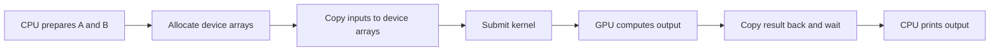

# Lesson 4 — Heterogeneous Architecture

## Book location

| Field | Reference |
|---|---|
| Book | Cheng, Grossman, and McKercher, *Professional CUDA C Programming* (2014) |
| Chapter | 1 — Heterogeneous Parallel Computing with CUDA |
| Section | Heterogeneous Computing (starts p. 8) |
| Subsection | Heterogeneous Architecture (starts p. 9) |
| Reading | Parent introduction pp. 8–9; subsection pp. 9–11; stop at Paradigm of Heterogeneous Computing on p. 12 |
| Roadmap ID | 1.2.1 — [learning roadmap](cuda-learning-path.md) |
| Experiment | Follow CPU orchestration, GPU work, and the return of vector-add results |
| Status | Implementation prepared; build/run record below; user profiling pending |

Roadmap IDs are navigation labels rather than printed section numbers.

## Core idea

Heterogeneous execution separates CPU coordination from GPU computation and requires an explicit data/completion contract.

**Code or evidence:** [vector_add.cpp](../../src/vector_add.cpp). The CPU allocates/copies/submits; VectorAddScalar adds on the GPU; a completed result copy lets CPU code consume the returned array.

**Original lesson commit:** `870a331`. This note explains that lesson;
the current main may have advanced to a later experiment.

## Theory and GPU architecture

### What makes computing heterogeneous?

A homogeneous system uses processors of the same architecture. A heterogeneous
system combines different processor architectures, such as CPU and GPU. The goal
is to assign useful work to suitable hardware, not to move every instruction to
the GPU. The CPU prepares and coordinates our operation; the GPU performs the
independent additions. A hardware accelerator performs selected work on behalf of
its host. Adding an accelerator also adds data-lifetime and coordination decisions.

### Host code versus device code

| Code | Where it executes | Role |
|---|---|---|
| `main.cpp` | CPU | Prepare inputs and print returned data |
| `VectorAdd` in `vector_add.cpp` | CPU | Allocate device storage, copy arrays, request a launch, and retrieve results |
| `LaunchVectorAddScalar` in `vector_add.cu` | CPU | Submit the CUDA launch |
| `VectorAddScalar`, marked `__global__` | GPU | Compute one sum per valid thread |
| `WriteThreadIndices`, marked `__global__` | GPU | Return each logical thread's global index |

A `.cu` file can contain both host and device code. Its extension does not mean
that every function in it runs on the GPU. Likewise, `cudaMemcpy` is called by the
CPU runtime code; a transfer call is not our arithmetic kernel.

### Following one value through the program

For block 1, local thread 5, the global index is `1 * 32 + 5 = 37`:

1. CPU initializes A[37] = 37 and B[37] = 10 in host vectors.
2. CPU allocates device arrays and requests copies of A and B into them.
3. CPU submits `VectorAddScalar` with two blocks of 32 threads.
4. GPU thread with global index 37 reads the device inputs and writes 47.
5. The result copy transfers device output into the host output vector and waits
   for completion before returning.
6. CPU prints 47 under the block/thread column belonging to index 37.

The mapping kernel separately computes 37 using the same formula. It does not
supply an index array to the addition kernel, and these launches do not identify
the same physical hardware threads or guarantee the same SM placement.

Console stage messages are printed by the CPU. The launch message is printed
before submission, not by executing GPU threads. The copy message is also printed
before its API call. Neither message alone proves that a GPU operation completed.

### Discrete GPUs in the book versus our Orin

Figure 1-9 depicts a discrete CPU/GPU arrangement with separate DRAM and a PCIe
connection. Orin integrates the CPU and GPU in a system-on-chip with shared
physical DRAM. Both still have distinct execution roles. Sharing physical memory
does not make our host vector and device allocation the same buffer: this program
explicitly allocates and copies between them. Mappings, caching, and synchronization
remain important. See [NVIDIA CUDA for Tegra](https://docs.nvidia.com/cuda/archive/13.2.2/cuda-for-tegra-appnote/index.html).

This lesson keeps explicit copies to make ownership visible. Managed or mapped
memory alternatives belong to later memory lessons; they are not silently enabled.
No PCIe bandwidth claim should be made from these Orin copies.

### Product families, capability, and performance

The book introduces Tegra, GeForce, Quadro, and Tesla as its historical product
families, and Fermi/Kepler as its example generations. Keep those names in their
2014 context. Our target is an Ampere-based Jetson Orin Nano with compute
capability 8.7; the build targets architecture 87.

| Term | Meaning | What it does not establish |
|---|---|---|
| CUDA core count | Arithmetic execution resources in a particular architecture | Number of software threads or a universal CPU/GPU speed ratio |
| Memory capacity | Storage available to hold data | Rate of computation or memory access |
| Peak compute performance | Idealized arithmetic rate for a specified precision/operation | Achieved performance of this tiny kernel |
| Memory bandwidth | Rate of data movement at a specified interface | Memory capacity or cache hit rate |
| Compute capability | Hardware feature/version designation used for CUDA targeting | CUDA Toolkit version or a measured speedup |

Review the Fermi/Kepler comparison and capability tables on pp. 10–11 as historical
examples of these distinctions. Core counts and advertised peaks across different
architectures are insufficient to predict our runtime. On an integrated device,
CPU, GPU, and system workloads also share memory resources.

## Implementation

Reuse the existing two kernels without modifying their computations. Keep the
2-block, 32-thread launch and horizontal display from lesson three. Add comments
and CPU-side messages that name the host/device stages in `main.cpp` and
`vector_add.cpp`. No new source modules, timers, argument checks, or automated
result comparisons are added.

## Experiment and expected GPU behavior

Follow the messages, then find A[37], B[37], and their sum in Block 1's rows.
The output still contains A = 0–63, B = 10, and sums = 10–73. Thread mapping still
returns 0–63. CPU labels describe the workflow, not timestamps or a timeline trace.

The unchanged 64-element workload exposes only two blocks, so low overall GPU
utilization is expected. This is an ownership/coordination exercise, not a new
kernel optimization. It does not measure whether GPU offload beats CPU execution.

## Build and validation

`make clean build run` succeeded on 2026-11-02, exit status 0.
Release build: GNU C++ 13.3.0, CUDA 13.2.86, CMake 3.28.3, architecture 87.
The CPU stage labels printed in order, followed by both block tables with indices
0–63 and sums 10–73. This was visual inspection, not an automated numerical
comparison. No timing or profiler capture was performed.
Previous lessons' outstanding profiling discussions remain open.

## User profiling and discussion

Use the [lesson 4 handout](../ncu-profiling/lesson-04-heterogeneous-architecture.md).
You capture `WriteThreadIndices` and `VectorAddScalar`. Distinguish observations
about device execution from the host/copy sequence explained by the source.

## Completion gate

- Explain homogeneous versus heterogeneous computing and host versus device roles.
- Identify which functions execute on the CPU, including the `.cu` launch wrapper.
- Trace one input through allocation, copying, computation, completion, and printing.
- Explain Orin's shared physical DRAM without equating host/device allocations.
- Distinguish capacity, bandwidth, peak compute, and compute capability.
- Discuss profiling limits before moving to Paradigm of Heterogeneous Computing (p. 12).

## Reading the kernel while learning

Use CUDA source → PTX first. `make ptx` generates only PTX, including `build/assembly/vector_add.ptx`
and `thread_mapping.ptx`. Selected exact vector-add PTX loads, addition, and store are reproduced with
inline explanations inside `VectorAddScalar` in `src/vector_add.cu`; address setup and other instructions
are omitted to keep attention on host/device roles. `make asm` still generates
both PTX and SASS. PTX describes typed operations using
virtual registers; it is not final machine code or a record of execution order.
Use SASS later for actual instruction selection and your ncu-ui metrics for
measured behavior. Host allocation, copies, and printing are not kernel PTX.
